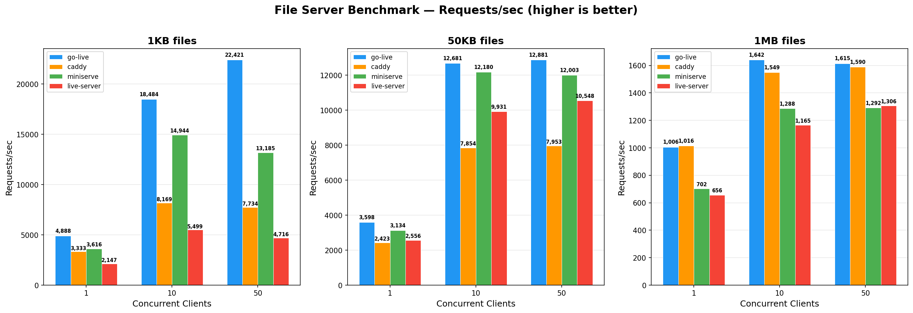

# go-live
[](https://goreportcard.com/report/github.com/antsankov/go-live)
[](https://pkg.go.dev/github.com/antsankov/go-live@v1.4.0?tab=overview)
[](https://snapcraft.io/go-live)


A really fast, super-tiny Go command line utility that serves a file directory over HTTP. Does one thing, and well. Can be used for local web development, production static-site serving, or as a network file host. By default, `go-live` serves the directory it is executed in.

Based on JavaScript's famous `live-server` utility. Supports Linux, Windows, and Mac, as well as ARM. See TODO list if interested in helping.

*To use*: Run `go-live` in your terminal while in directory you want to serve.

## Use-Cases
* Local development of an HTML/JS project (can serve any frontend code).
* Host a production static site yourself as a GitHub Pages alternative. [See tutorial here](https://antsankov.medium.com/how-to-host-your-own-github-pages-server-on-digital-ocean-in-less-than-15-minutes-using-go-live-82300a16e23a)
* A lightweight network file host that can serve over a LAN or the whole Internet.
* Run on an embedded system or Kubernetes cluster to share files and host a static website on a network (full binary is less than 5MB).

## Example


## Install

### MacOS and Linux (with Brew)
`brew install antsankov/go-live/go-live`

### MacOS x64 (without Brew)

`curl -LJO https://github.com/antsankov/go-live/releases/latest/download/go-live-mac-x64.zip && unzip go-live-mac-x64.zip && mv go-live /usr/local/bin/go-live && chmod +x /usr/local/bin/go-live && go-live`

### MacOS Apple Silicon/M1/M2 (without Brew)

`curl -LJO https://github.com/antsankov/go-live/releases/latest/download/go-live-mac-arm64.zip && unzip go-live-mac-arm64.zip && mv go-live /usr/local/bin/go-live && chmod +x /usr/local/bin/go-live && go-live`

### Linux (using Snapcraft)
`snap install go-live`

### Linux x64 (Ubuntu/RHEL/etc.):
`sudo wget https://github.com/antsankov/go-live/releases/latest/download/go-live-linux-x64 -O /usr/bin/go-live && sudo chmod +x /usr/bin/go-live`

### Linux ARM64 (Ubuntu/RHEL/etc.):
`sudo wget https://github.com/antsankov/go-live/releases/latest/download/go-live-linux-arm64 -O /usr/bin/go-live && sudo chmod +x /usr/bin/go-live`

### Docker
`docker pull antsankov/go-live`

To run (will serve current directory on port 9000):

`docker run --rm -v "${PWD}":/workdir -p 9000:9000 antsankov/go-live go-live`

### Windows
`winget install antsankov.go-live`

Or download directly:
* [x64](https://github.com/antsankov/go-live/releases/latest/download/go-live-windows-x64.exe)
* [ARM64](https://github.com/antsankov/go-live/releases/latest/download/go-live-windows-arm64.exe)

- Chocolatey coming soon! (Help wanted)
- Make sure when running that all necessary ports are open and user has permissions (Help wanted)
- QT based front-end? (Help wanted)

### Go Install (must have Go installed)
`go install github.com/antsankov/go-live@latest`

### Install From Source (must have Go installed)
```
git clone https://github.com/antsankov/go-live.git && cd go-live
make build && ./bin/go-live
```
### Cross Compile for multiple systems
```
git clone https://github.com/antsankov/go-live.git && cd go-live
make cross-compile VERSION=x.y.z && ls release/
```

## To Release
1. Set the new version in `main.go` (`VERSION`), `Dockerfile` (`LABEL version`) and `snap/snapcraft.yaml` (`version`). `release.sh` refuses to run if any of them disagree with the tag.
2. Commit, then tag and push:
```
git tag v1.4.0 && git push origin v1.4.0
```

`.github/workflows/release.yml` then runs `release.sh`, which:
- builds macOS, Linux and Windows binaries (x64 + arm64) with `make cross-compile`
- signs and notarizes the macOS binaries, and Authenticode-signs the Windows `.exe`s
- publishes them with `SHA256SUMS` to the GitHub Release
- updates the Homebrew formula in `antsankov/homebrew-go-live`
- opens a winget-pkgs pull request for `antsankov.go-live`

A follow-up job packs the Linux binaries into snaps (amd64 + arm64) and releases them to the Snap Store stable channel.

`release.sh` can also be run locally on a Mac (`./release.sh v1.4.0`) with the same environment variables set and `brew install osslsigncode komac`. It fails fast and lists every missing secret or tool. Run from a clean checkout of the existing tag. Existing releases are rejected to prevent replacing published assets. If publication succeeds but a package registry update fails, complete that registry update separately; do not delete or replace the release.

Required secrets (store these in the `release` GitHub environment):

| Secret | Value |
|--------|-------|
| `APPLE_CERT_P12_BASE64` | Developer ID Application certificate exported as .p12: `base64 -i cert.p12 \| pbcopy` |
| `APPLE_CERT_PASSWORD` | Password of the .p12 export |
| `APPLE_SIGNING_IDENTITY` | e.g. `Developer ID Application: Name (TEAMID)` (see `security find-identity -p codesigning`) |
| `APPLE_ID` | Apple ID email used for notarization |
| `APPLE_TEAM_ID` | Apple Developer Team ID |
| `APPLE_APP_PASSWORD` | App-specific password from appleid.apple.com |
| `WINDOWS_CERT_PFX_BASE64` | Authenticode code-signing certificate .pfx: `base64 -i cert.pfx \| pbcopy` |
| `WINDOWS_CERT_PASSWORD` | Password of the .pfx |
| `HOMEBREW_TAP_TOKEN` | GitHub token with push access to `antsankov/homebrew-go-live` |
| `WINGET_TOKEN` | Classic GitHub token with `public_repo` scope (used to fork and open PRs on `microsoft/winget-pkgs`) |
| `SNAPCRAFT_STORE_CREDENTIALS` | Output of `snapcraft export-login --snaps=go-live --acls=package_access,package_push,package_release -` |

One-time setup:
- GitHub: configure the `release` environment with required reviewers and deployment restrictions before enabling this workflow. Protect release tags (`v*`) against unauthorized creation, updates and deletion with a repository ruleset. Tagged scripts, Makefiles, tests and Snap configuration execute on runners that later receive publishing credentials, so only reviewed commits may be released. Manual dispatch must also use a trusted workflow ref. These controls must be configured in repository settings.
- Homebrew: scope `HOMEBREW_TAP_TOKEN` to contents write access on the tap repository only. The Snap credential is only passed to the Snap upload step.
- winget: the first submission must be created by hand with `komac new antsankov.go-live`; later releases are updated automatically.
- snap: disconnect the snapcraft.io GitHub auto-build, since `snap/snapcraft.yaml` now packages the release binaries instead of building from source.

Docker is still manual (remember for version and for latest): `sudo docker build -t antsankov/go-live:v1.4.0 .` and `sudo docker push antsankov/go-live:v1.4.0`

## Flags
```
  -h  Print help message for go-live
  --help

  -c	Allow browser caching of pages. Can lead to stale results, off by default.
  --cache

  -d string
    	Select the directory you want to serve. Serves all subpaths that user has read permissions for. (default "./")
  --dir string
    	 (default "./")
  -p string
    	Set port to serve on. (default "9000")
  --port string
    	 (default "9000")
  -q	Quiet stops go-live from opening the browser when started.
  --quiet

  -s	Start in server mode on port 80 and in quiet.
  --serve

  -S	Enable HTTPS/TLS mode. Uses a self-signed certificate if --cert and --key are not provided.
  --https

  --cert string
    	Path to TLS certificate PEM file.

  --key string
    	Path to TLS private key PEM file.

  -v	Print the version of go-live.
  --version
```

Note: `index.html` is displayed automatically at the root of a directory.

**Example**: Serve a static site over Port 80

`sudo go-live --dir ~/example.com/ --serve`

### HTTPS

Serve with an auto-generated self-signed certificate:

`go-live --https`

Serve with your own certificate:

`go-live --https --cert server.pem --key server-key.pem`

Providing `--cert` and `--key` automatically enables HTTPS.

## Benchmarks

go-live vs caddy (Go), miniserve (Rust), and live-server (Node.js) serving files over HTTP on an Apple M2 Pro.

| Server | Version | Language | Binary Size |
|--------|---------|----------|-------------|
| go-live | v1.3.0 | Go | 5.8 MB |
| caddy | v2.11.1 | Go | 70 MB |
| miniserve | v0.33.0 | Rust | 5.3 MB |
| live-server | v1.2.2 | Node.js | 9.2 MB + 76 MB Node.js runtime |



Requests/sec measures fully completed, successful HTTP requests where the entire response body was downloaded. For example, 165 req/s on a 10MB file means ~1.65 GB/s of delivered data.

go-live is the fastest across all file sizes and concurrency levels. For small files at 50 concurrent clients, go-live handles **22,421 req/s** — 2.9x caddy, 1.7x miniserve, and 4.8x live-server.

### Why is go-live fast?

Go's `net/http` file server uses `sendfile(2)` — a kernel syscall that transfers file data directly from disk to the network socket without copying through userspace. This zero-copy path is why go-live and caddy (also Go) lead on large files.

miniserve (Rust/hyper/tokio) does not use `sendfile`. Every byte goes disk → kernel → userspace → kernel → socket. Tokio also fakes async file I/O by dispatching blocking reads to a thread pool, adding context-switching overhead. This is why miniserve falls behind even Node.js's live-server on larger files, despite being faster on small files where raw request processing speed matters more.

Run benchmarks yourself:
```
make bench-compare
```

## TODO (Help Wanted)
- [ ] Android Support
- [x] Docker Support
- [x] Benchmarking and performance tests. Large files, and concurrent connections.
- [x] Gif and Screenshots of it in use.
- [x] Tutorial Use as Github Pages Alternative
- [x] Copy Paste from Terminal fix.
- [x] Finish Gitbook documentation.
- [x] HTTPS support.
- [x] Publish as a Go package.
- [x] Setup Unit tests.
- [x] Requests Counter
- [x] Ability to download as a binary.
- [x] Browser Opening
- [x] Finish Go Deps
- [x] Run as shell utility.
- [x] Figure out rotating print message.
- [x] Get local server going.
